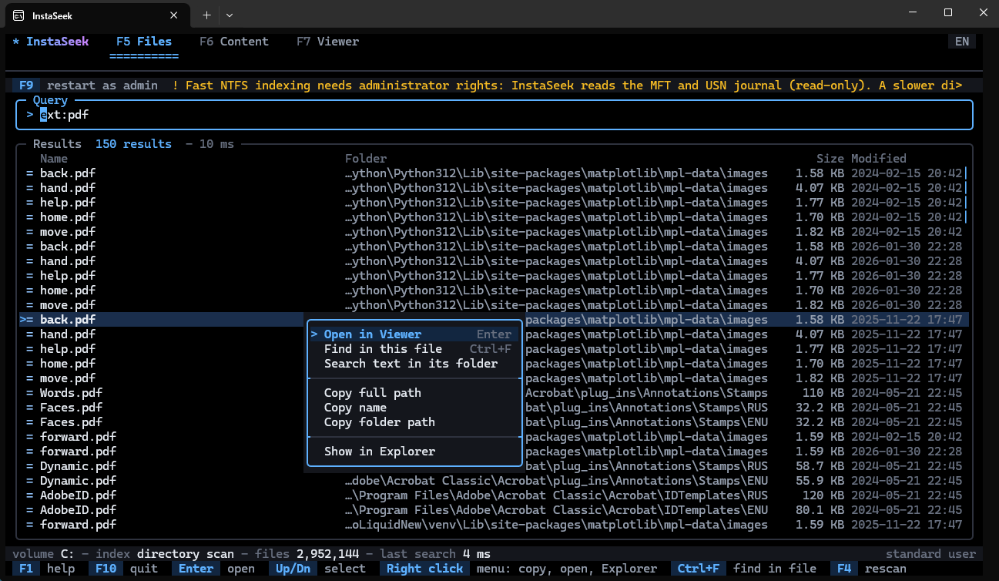
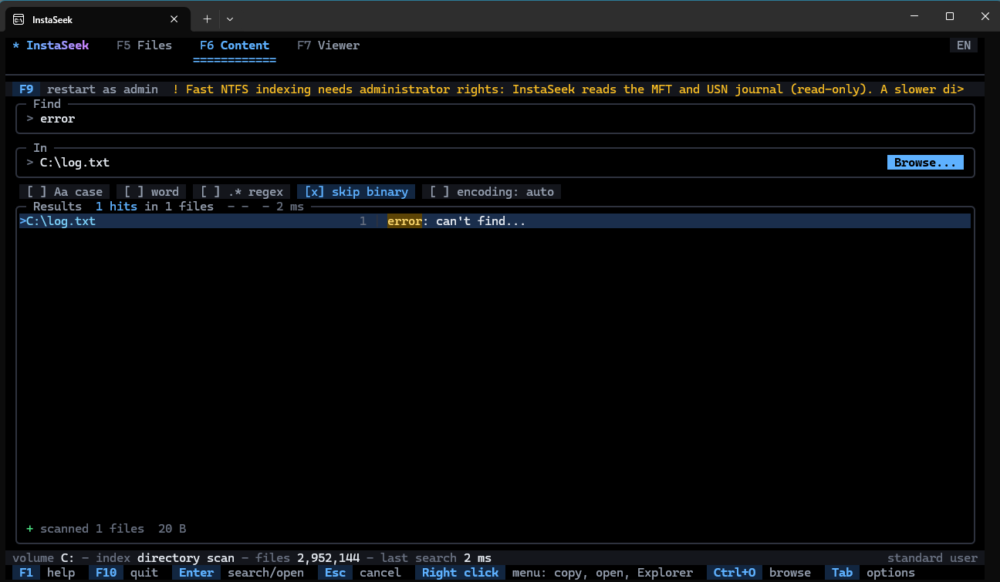
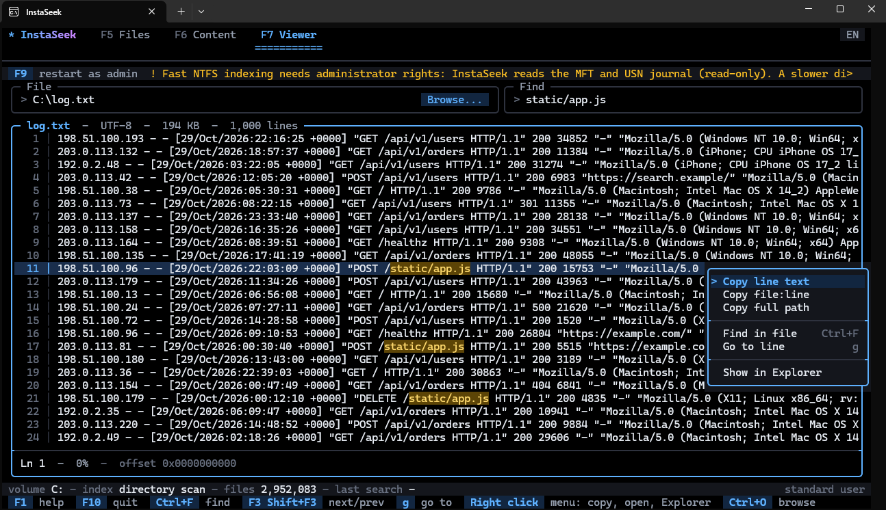

# InstaSeek

**Instant file name search across a whole disk and fast text search inside multi‑gigabyte files, in one terminal app for Windows.**

InstaSeek reads the NTFS Master File Table to index millions of files in seconds, keeps the index current through the USN journal, searches file contents with memory‑mapped I/O on every CPU core, and opens files of any size in a viewer that never loads them whole. It is a single portable `instaseek.exe` with a keyboard‑and‑mouse terminal UI on a pure black background and English/Russian interfaces.



| Content search | Viewer |
|---|---|
|  |  |

---

## Features

**Files: search names on the whole disk**
- Indexes an NTFS volume straight from the MFT (`FSCTL_ENUM_USN_DATA`): about two million files in a few seconds.
- Live updates: a background thread follows the USN journal (`FSCTL_READ_USN_JOURNAL`), so new, renamed and deleted files show up without rescanning.
- Sizes and modification dates are filled in by a background pass right after the names are ready.
- Works without administrator rights too: it falls back to a directory scan with `FindFirstFileExW` and `FIND_FIRST_EX_LARGE_FETCH`. Non‑NTFS volumes use the same fallback.
- Case‑insensitive substring search, Cyrillic included. Several words mean AND, `a|b` means OR, and searches run in parallel on all cores. Results are ranked: exact name, then prefix, then word start, then the rest.
- Filters: `ext:pdf,docx`, `size:>100mb`, `size:1mb..2gb`, `modified:>2024-01-01`, `modified:today`, `modified:7d`, `type:folder`, `path:projects`, `!exclude`, `"quoted words"`.

**Content: search text inside files**
- Works on a single file or a whole folder tree, with no index to build. Type the path, paste it, or press `Browse...` to pick it in the Windows dialog.
- Files are memory‑mapped in windows with `CreateFileMapping`/`MapViewOfFile`, so files over 4 GB work. Large files are split into blocks searched in parallel, and matches on block boundaries are handled exactly once.
- Modes:
  - plain text with a Boyer–Moore–Horspool search;
  - any of several words: `error|warning`;
  - case‑insensitive;
  - whole word, Unicode‑aware;
  - [RE2](https://github.com/google/re2) regular expressions.
- Encodings: UTF‑8, UTF‑16 LE/BE and Windows‑1251. The encoding is detected from the BOM or a heuristic, and you can also pick it manually.
- Results stream in while the search runs, with progress, throughput, cancellation (`Esc`) and a result limit. Each result shows `file : line : text`, with context and the match highlighted.

**Viewer: open files of any size instantly**
- Only the visible part of the file is mapped, so a 20 GB log opens immediately.
- The line offset table is built in the background. Until it is ready, the viewer works by byte offset and shows hex offsets in the gutter.
- Go to a line, a byte offset (`0x1F00`) or a position (`50%`).
- Scroll with the keyboard or the mouse and use horizontal scroll for long lines.
- A find bar sits next to the path field: `Ctrl+F` jumps into it, matches are highlighted as you type, and `Enter`, `F3` or `Shift+F3` step to the next or previous match.
- Opening a content search result jumps straight to the matching line and flashes it.

**Interface**
- Full‑screen TUI built with [FTXUI](https://github.com/ArthurSonzogni/FTXUI). It works with the keyboard and the mouse, and letter shortcuts also work in the Russian keyboard layout.
- One theme on a pure black background, with contrast‑checked accent, match, warning and error colors defined in a single palette.
- Right click anything for a context menu:
  - a file: open, find inside, copy path, name or folder, show in Explorer;
  - a content match: open at the line, copy the line text, copy `file:line`, copy path, show in Explorer;
  - a viewer line: copy it, copy `file:line`, find, go to line;
  - a text field: paste, copy, cut, select all, clear.

  `Shift+F10` opens the same menu from the keyboard.
- Text fields work like a normal editor: select with `Shift`+arrows, `Ctrl+A`, a mouse drag or a double click; `Ctrl+V` pastes and `Ctrl+X` cuts. `Ctrl+C` is deliberately unbound, so it can never close or break the console.
- `Browse...` buttons next to the location and file fields open the standard Windows dialog to pick a file or a folder (`Ctrl+O`).
- Animations:
  - splash screen;
  - sliding tab indicator;
  - results that fade in;
  - soft hover and selection highlights;
  - a flash on the line a search jumps to;
  - animated progress bars and counters.
  
  Frames are only requested while something is moving, so the app is idle when you are, and `--no-anim` turns all of it off.
- Unicode file type icons, with an ASCII fallback for older consoles.

**Safety**
- InstaSeek only reads. It never writes, renames or deletes anything on disk, and it does not save settings.
- No telemetry and no network access.
- Access‑denied folders and files are skipped and counted, never fatal. Paths longer than `MAX_PATH` and Unicode names are supported.

---

## Installation

Download `instaseek.exe` from the [Releases](../../releases) page and run it. It is a single 64‑bit executable with the static C runtime. Nothing to install, no DLLs.

Requirements: Windows 10 or 11, x64. [Windows Terminal](https://aka.ms/terminal) is recommended for the best colors, icons and mouse support.

For instant NTFS indexing run it as administrator. Without elevation it still works, using the slower directory scan, and offers to restart elevated (`F9`).

---

## Usage

```
instaseek [options] [path]

  path                   a file opens in the Viewer, a folder becomes the Content search location
  --drive X              volume to index (default: the system drive)
  --lang en|ru           interface language, default: en
  --icons unicode|ascii  glyph set, default: detected from the terminal
  --no-anim              disable all animations
  --version, --help
```

Examples:

```
instaseek
instaseek --drive D
instaseek C:\logs
instaseek D:\dumps\huge.log --lang ru
```

### Query syntax (Files mode)

| Query | Meaning |
|---|---|
| `report 2024` | names containing both words |
| `report|invoice`, `report | invoice` | names containing either word |
| `2024 report|invoice` | `2024` and (`report` or `invoice`) |
| `"annual report"` | the exact phrase |
| `ext:pdf,docx` | by extension |
| `size:>100mb`, `size:<1k`, `size:1mb..2gb` | by size (`b`, `kb`, `mb`, `gb`, `tb`) |
| `modified:>2024-01-01`, `modified:2024-03-15`, `modified:2024-01-01..2024-01-31` | by modification date (local time) |
| `modified:today`, `modified:yesterday`, `modified:7d`, `modified:week` | recent changes |
| `type:folder`, `type:file` | only folders or only files |
| `path:projects\api` | the full path contains the text |
| `!tmp` | exclude names containing the text |

### Keyboard

| Key | Action |
|---|---|
| `F5` / `F6` / `F7` | Files / Content / Viewer |
| `Up` `Down` `PgUp` `PgDn`, mouse wheel | move through results |
| `Enter`, double click | open the result: a file in the Viewer, a folder in Content search |
| `Tab` | next field or option, `Space` toggles an option |
| `Esc` | cancel a search, close a dialog, leave the document |
| `F4` | rebuild the file index |
| `F9` | restart as administrator |
| `F1` | help |
| `F2` | English / Russian |
| Right click, `Shift+F10` | context menu: copy, open, show in Explorer, paste |
| `Ctrl+V` / `Ctrl+X` | paste / cut in a text field |
| `Ctrl+O`, `Browse...` | pick a file or a folder in the Windows dialog |
| `Shift`+arrows, `Ctrl+A`, mouse drag | select text in a field |
| `Ctrl+F` | Files/Content: open the selected result and search inside it; Viewer: jump to the find bar |
| `F3` / `Shift+F3` | Viewer: next / previous match |
| `F10`, `Ctrl+Q` | quit |
| Viewer: `g` | go to a line, `0x` offset or `%` |
| Viewer: `/` or `f` | find in the file |
| Viewer: `n` / `N` | next / previous match |
| Viewer: `Left` `Right`, `Home` `End` | horizontal scroll, start and end of the file |

---

## How it works

### Name index (MFT + USN journal)

On NTFS every file and folder has a record in the Master File Table. Opening the volume (`\\.\C:`) and calling `FSCTL_ENUM_USN_DATA` returns all MFT records in large batches. Each batch gives a file reference number, the parent reference, the attributes and the name, which is everything needed to rebuild the tree without touching a single directory.

The index stores records compactly: one contiguous buffer of UTF‑8 names, a parallel buffer of case‑folded names (same byte offsets), and a vector of 32‑byte records `{size, mtime, name offset, parent index, name length, flags}`. File reference numbers map to record indices through a dense table, and full paths are rebuilt on demand by walking parent links. A search is a parallel scan of the folded names with `std::string_view::find`, which is fast because the data is contiguous and cache‑friendly.

The USN journal records every change on the volume. After the initial enumeration a background thread reads it once a second with `FSCTL_READ_USN_JOURNAL`, starting from the position captured before enumeration, and applies creates, renames, moves and deletes to the index under a reader–writer lock.

The MFT enumeration does not return sizes or dates, so a second background pass lists every directory by ID (`OpenFileById` + `FileIdBothDirectoryInfo`) and fills them in.

Without administrator rights the volume handle cannot be opened. InstaSeek then walks the tree with `FindFirstFileExW` (`FindExInfoBasic`, `FIND_FIRST_EX_LARGE_FETCH`), which is slower but needs no privileges.

### Content search (memory mapping)

A file is mapped with `CreateFileMapping`, and views of 32 MB are mapped with `MapViewOfFile` as needed, so neither file size nor address space is a problem. Each block owns the lines that *start* inside it. Its view extends a little past its end to finish the last line, which is how a match crossing a block boundary is found exactly once. Newlines are counted per block, and a prefix sum turns local line numbers into global ones, so results stream in file order even when blocks finish out of order.

Plain case‑sensitive text uses `std::boyer_moore_horspool_searcher`. A plain pattern with `|`, such as `error|warning`, becomes an escaped RE2 alternation and finds any of the parts; to search for a literal `|`, switch on regex mode and write `\|`. Case‑insensitive text and regular expressions use RE2, which matches in linear time with Unicode case folding. Whole‑word matching is checked against Unicode letters, so it works for Cyrillic too. UTF‑16 and Windows‑1251 files are decoded to UTF‑8 line by line while keeping the original byte offsets for the viewer.

### Viewer

The viewer maps only the region it shows. A background thread counts lines and stores a checkpoint every 256 lines. Jumping to a line uses the nearest checkpoint plus a short scan, and until the table reaches a position the viewer navigates by byte offset.

---

## Building from source

### Requirements

- Windows 10/11 x64.
- Visual Studio 2022 (Community is fine) with the **Desktop development with C++** workload, including *MSVC v143 x64/x86 build tools*, a *Windows SDK* and *C++ CMake tools for Windows* (this provides CMake and Ninja).
- Git.
- [vcpkg](https://github.com/microsoft/vcpkg), as a full git clone.

### vcpkg setup

```powershell
git clone https://github.com/microsoft/vcpkg C:\dev\vcpkg
C:\dev\vcpkg\bootstrap-vcpkg.bat -disableMetrics
[Environment]::SetEnvironmentVariable("VCPKG_ROOT", "C:\dev\vcpkg", "User")
```

Open a new terminal afterwards. The presets read `VCPKG_ROOT` and use the `x64-windows-static` triplet. Dependencies (FTXUI 5.0.0 and RE2) are declared in `vcpkg.json` and installed automatically on the first configure. That first configure takes a while, because RE2 pulls in Abseil.

> The *Developer PowerShell for VS* sets its own `VCPKG_ROOT` that points to the copy of vcpkg bundled with Visual Studio. Set it back with `$env:VCPKG_ROOT = "C:\dev\vcpkg"` in that shell.

### ⚠ x64 only

InstaSeek must be built as a 64‑bit program. The default *Developer PowerShell for VS 2022* targets **x86**, and CMake stops with a clear error in that case. Use an x64 environment instead:

```powershell
$vs = & "${env:ProgramFiles(x86)}\Microsoft Visual Studio\Installer\vswhere.exe" -latest -property installationPath
Import-Module "$vs\Common7\Tools\Microsoft.VisualStudio.DevShell.dll"
Enter-VsDevShell -VsInstallPath $vs -SkipAutomaticLocation -DevCmdArguments "-arch=x64 -host_arch=x64"
$env:VCPKG_ROOT = "C:\dev\vcpkg"
```

If a 32‑bit configure already happened, delete the `build` folder before trying again.

### Build with presets

| Preset | Generator | Output |
|---|---|---|
| `release` | Ninja, x64, Release | `build/release/instaseek.exe` |
| `debug` | Ninja, x64, Debug | `build/debug/instaseek.exe` |
| `vs2022` | Visual Studio 17 2022, x64 | `build/vs2022/Release/instaseek.exe` |

```powershell
cmake --preset release
cmake --build --preset release
ctest --preset release
```

With the Visual Studio generator (no x64 shell needed, the preset forces x64):

```powershell
cmake --preset vs2022
cmake --build --preset vs2022-release
ctest --preset vs2022-release
```

Visual Studio 2022 and VS Code with the CMake Tools extension pick up `CMakePresets.json` automatically: open the folder and choose a preset.

### Build settings

- C++20, MSVC with `/W4 /permissive- /utf-8 /sdl /guard:cf`.
- Linker hardening: `/DYNAMICBASE /NXCOMPAT /HIGHENTROPYVA /guard:cf /CETCOMPAT` (ASLR, DEP, Control Flow Guard, CET).
- Static CRT (`/MT`) and the `x64-windows-static` triplet produce a single portable `.exe`.
- The test suite (`tests/`) uses a tiny built‑in harness and runs through `ctest`. It covers:
  - block‑boundary search;
  - encodings;
  - query parsing;
  - path reconstruction;
  - regular expressions;
  - the line index;
  - text field editing: selection, word jumps, paste sanitizing;
  - palette interpolation and contrast.
- GitHub Actions builds and tests every push on `windows-latest`.

### Project layout

```
src/core       platform-independent logic: index, queries, encodings, matching, block search, palette
src/platform   Win32: MFT/USN, directory walking, memory mapping, index service, content scanner, document
src/ui         FTXUI interface: pages, text fields, widgets, palette, animations, i18n
tests          unit tests
```

---

## Limitations

- Fast indexing needs NTFS and administrator rights. Otherwise the directory scan is used, which can take minutes on large disks and has no live updates (press `F4` to rescan).
- One volume is indexed at a time (`--drive`).
- Hard links appear under one of their names only.
- Name search is a substring search, with no fuzzy matching or wildcards.
- Size and date filters only see files whose metadata has already been read. A notice is shown while the background pass is running.
- Content search and the viewer split lines on `\n`. Lines longer than 1 MB are cut for search, and lines longer than 64 KB wrap in the viewer.
- For UTF‑16 and Windows‑1251 files, a jump from a search result lands on the line, not on the exact column.
- RE2 does not support backreferences or lookaround.
- Wide CJK characters and emoji depend on the terminal font. Use `--icons ascii` if icons show as boxes.
- The UI requires a terminal of at least 80×24.

---

## License

[MIT](LICENSE)
